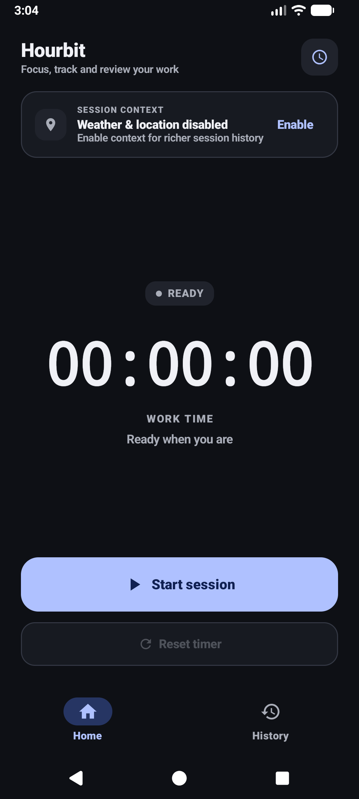
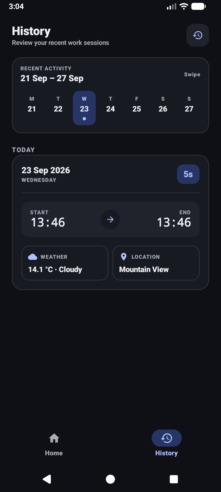

<div align="center">


# Hourbit

### Focus. Track. Review.

A modern Android work-session tracker built with **Kotlin**, **Jetpack Compose**, **Room**, **Retrofit**, and **MVVM**.

<br>


<br><br>

</div>

---

## 📱 Overview

**Hourbit** is an Android application for tracking focused work sessions and breaks.

A completed session can contain more than just a duration. Hourbit can optionally attach the **location**, **city**, **temperature**, and **weather conditions** that were present when the session ended.

The application was developed as an Android final project with a focus on clean architecture, persistent local data, API integration, reactive state management, error handling, and a polished Compose interface.

---

## ✦ Screenshots

<div align="center">

<table>
<tr>
<td align="center" width="50%">

</td>
<td align="center" width="50%">

</td>
</tr>
</table>

</div>

---

## ✨ Features

<table>
<tr>
<td width="50%" valign="top">

### ⏱ Session tracking

- Start and stop work sessions
- Live `HH:MM:SS` timer
- Separate break tracking
- Resume work after a break
- Work duration excludes break duration
- Reset completed timer state

</td>
<td width="50%" valign="top">

### 💾 Persistence

- Completed sessions stored with Room
- Active session state survives app restarts
- Timestamp-based timer reconstruction
- Persistent break state
- Reactive history using Kotlin Flow

</td>
</tr>

<tr>
<td width="50%" valign="top">

### 🌤 Session context

- Optional device location
- Latitude and longitude
- Reverse-geocoded city name
- Current temperature
- WMO weather code
- Human-readable weather condition

</td>
<td width="50%" valign="top">

### 📅 History

- Seven-day activity calendar
- Swipe horizontally into previous weeks
- Sessions grouped by date
- Work and break durations
- Start and end times
- Weather and city metadata

</td>
</tr>

<tr>
<td width="50%" valign="top">

### 🗑 Session management

- Swipe a history card to reveal Delete
- Rubber-band swipe interaction
- Explicit delete action
- Confirmation dialog
- Room updates reflected automatically

</td>
<td width="50%" valign="top">

### 🎨 Interface

- Jetpack Compose
- Custom light theme
- Custom dark theme
- Dedicated work, break and destructive colors
- Bottom navigation
- Portrait-optimized layout

</td>
</tr>

<tr>
<td width="50%" valign="top">

### 📱 Home-screen widget

- Interactive Android home-screen widget
- Live work timer
- Live break timer
- Start, break and resume controls
- Shared active-session state with the app
- Quick access back into Hourbit

</td>
<td width="50%" valign="top">

### 🔄 Session continuity

- Widget and app use the same persisted session state
- Work time is reconstructed from timestamps
- Break time remains separate from focused work
- Session completion stays in the app workflow
- Completed sessions remain the responsibility of Room

</td>
</tr>
</table>

---

## 🏗 Architecture

Hourbit follows an **MVVM architecture with a Repository layer**.

```text
┌───────────────────────┐
│      Compose UI       │
│ HomeScreen / History  │
└───────────┬───────────┘
            │
            ▼
┌───────────────────────┐
│      ViewModels       │
│ HomeVM / HistoryVM    │
└───────────┬───────────┘
            │
            ▼
┌───────────────────────┐
│ WorkSessionRepository │
└────────┬─────────┬────┘
         │         │
         ▼         ▼
┌─────────────┐  ┌─────────────┐
│    Room     │  │  Retrofit   │
│ Local data  │  │ Open-Meteo  │
└─────────────┘  └─────────────┘

┌───────────────────────┐
│   Home-screen Widget  │
│     RemoteViews       │
└───────────┬───────────┘
            │
            ▼
┌───────────────────────┐
│   SessionStateStore   │
│   SharedPreferences   │
└───────────────────────┘
```

The UI does not directly access Room or the weather API.

1. The **Compose UI** displays state and sends user actions.
2. The **ViewModel** manages application logic and UI state.
3. The **Repository** provides access to local and remote data.
4. **Room** stores completed work sessions.
5. **Retrofit** communicates with Open-Meteo.

---

## 🧠 Timer design

Hourbit does not use an incrementing counter as the source of truth.

Instead, the timer is calculated from real timestamps.

```text
Session start
     │
     ├──────── Work ────────┐
     │                      │
     │   Break start        │
     │       │              │
     │       └── Break ─────┤
     │                      │
     │   Resume work        │
     │                      │
     └────────────── Session end
```

The effective work duration is:

```text
Work time = Total session duration - Total break duration
```

This allows an active session to be reconstructed after the app is reopened instead of losing the timer state.

### Active-session persistence

While a session is active, Hourbit stores:

- session start timestamp
- whether a break is active
- break start timestamp
- accumulated break duration
- running state

This temporary state is stored with `SharedPreferences` through `SessionStateStore`.

Completed sessions are stored separately in Room.

---

## 📱 Home-screen widget

Hourbit includes an interactive Android home-screen widget built with `AppWidgetProvider` and `RemoteViews`.

The widget uses the same persisted active-session state as the main application and provides quick access to the current session without requiring Hourbit to remain open.

Depending on the current state, the widget can display:

- **Ready** — start a new work session
- **Focusing** — show a live work timer and start a break
- **On break** — freeze the work timer, show a live break timer and resume work

The widget reconstructs elapsed time from timestamps instead of maintaining a separate counter. This keeps its timer consistent with Hourbit's timer design.

Finishing a session returns the user to Hourbit, where the normal completion flow can retrieve optional location and weather information before storing the completed session in Room.

---

## 💾 Data model

Completed sessions are represented by `WorkSession`.

```text
WorkSession
│
├── id
├── startTime
├── endTime
├── breakDurationSeconds
│
├── latitude
├── longitude
├── cityName
│
├── temperature
└── weatherCode
```

Location and weather information are nullable because neither is required for the core timer functionality.

---

## 📍 Location & city detection

Hourbit uses the **Fused Location Provider** from Google Play Services.

When a session ends:

```text
Device
   │
   ▼
Fused Location Provider
   │
   ▼
Latitude + Longitude
   │
   ▼
Android Geocoder
   │
   ▼
Readable city name
```

Location permission is optional. If location cannot be retrieved, the session is still saved.

---

## 🌦 Weather API

Hourbit uses the free **Open-Meteo API**. No API key is required.

Requested values:

```text
temperature_2m
weather_code
```

Endpoint:

```text
https://api.open-meteo.com/v1/forecast
```

The saved WMO weather code is translated into a readable condition and corresponding UI icon.

| Code | Display |
|---:|---|
| `0` | Clear |
| `1–3` | Cloudy |
| `45–48` | Fog |
| `51–57` | Drizzle |
| `61–67` | Rain |
| `71–77` | Snow |
| `80–82` | Showers |
| `95–99` | Thunderstorm |

Weather is requested only when coordinates are available. If the request fails, the session is still saved.

---

## 📅 History experience

The History screen is centered around a swipeable **weekly calendar** running from Monday to Sunday.

<div align="center">

`Current week` → swipe → `Previous week` → swipe → `Earlier weeks`

</div>

The session list follows the visible calendar period automatically.

Each session can show:

<table>
<tr>
<td>📆 Date</td>
<td>⏱ Work duration</td>
</tr>
<tr>
<td>🕐 Start / end time</td>
<td>☕ Break duration</td>
</tr>
<tr>
<td>🌤 Weather</td>
<td>📍 City</td>
</tr>
</table>

---

## ↩ Swipe-to-delete

History entries use a custom swipe interaction instead of immediately deleting at a swipe threshold.

```text
Normal card
      │
      │ swipe left
      ▼
┌───────────────────────┐██████████
│ Session               │ 🗑 Delete
└───────────────────────┘██████████
```

The card settles with the delete action revealed. The user must explicitly tap **Delete**, after which a confirmation dialog appears.

This prevents accidental deletion while keeping the interaction fast.

---

## ⚠️ Error handling

Optional features do not block the core session flow.

```text
Location unavailable
        ↓
Save session without location

Weather unavailable
        ↓
Save session without weather
```

Database and API operations are wrapped in error handling so failures can be surfaced to the UI instead of crashing the application.

---

## 🔐 Permissions

Hourbit uses:

```xml
android.permission.ACCESS_FINE_LOCATION
android.permission.ACCESS_COARSE_LOCATION
android.permission.INTERNET
```

Location permission is optional.

Internet access is used for weather requests.

---

## 🧭 Navigation

Hourbit uses **type-safe Navigation Compose routes**.

```text
HomeRoute
HistoryRoute
```

The bottom navigation switches directly between the two main sections without manually maintained route strings.

---

## 🧰 Tech stack

| Area | Technology |
|---|---|
| Language | Kotlin |
| UI | Jetpack Compose |
| Architecture | MVVM + Repository |
| Database | Room |
| Networking | Retrofit |
| Weather API | Open-Meteo |
| Location | Google Play Services Location |
| Navigation | Navigation Compose |
| State | StateFlow / Flow |
| Concurrency | Kotlin Coroutines |
| Active session state | SharedPreferences |
| Home-screen widget | AppWidgetProvider + RemoteViews |
| Build system | Gradle Kotlin DSL |

---

## 📂 Project structure

```text
com.arj4ng.hourbit
│
├── data
│   ├── local
│   │   ├── HourbitDatabase
│   │   ├── WorkSession
│   │   ├── WorkSessionDao
│   │   └── SessionStateStore
│   │
│   ├── location
│   │   └── LocationProvider
│   │
│   ├── remote
│   │   ├── RetrofitClient
│   │   └── WeatherApi
│   │
│   └── WorkSessionRepository
│
├── ui
│   ├── home
│   │   ├── HomeScreen
│   │   ├── HomeViewModel
│   │   └── HomeViewModelFactory
│   │
│   ├── history
│   │   ├── HistoryScreen
│   │   ├── HistoryViewModel
│   │   └── HistoryViewModelFactory
│   │
│   ├── navigation
│   └── theme
│
├── widget
│   └── HourbitWidgetProvider
│
└── MainActivity
```

---

## 🎨 Design system

Hourbit uses a custom color system for both light and dark mode.

| Color role | Meaning |
|---|---|
| 🔵 Blue | Active work, primary actions, selected states |
| 🟠 Amber | Breaks and paused work |
| 🔴 Red | Destructive actions |
| ⚪ Neutral | Surfaces, metadata, secondary UI |

The app follows the device light/dark appearance and is optimized for portrait use.

---

## 🚀 Build

Clone the repository and build the debug APK:

```bash
./gradlew assembleDebug
```

Or install directly on a connected device/emulator:

```bash
./gradlew installDebug
```

---

## 🔭 Possible future improvements

- Session titles or project/category assignment
- Daily and weekly statistics
- Charts for working time and breaks
- Manual editing of completed sessions
- Export to CSV
- Search and filtering
- Configurable work goals
- Notifications or reminders
- Cloud synchronization
- Tablet layouts

---

## 🎓 Project context

Hourbit was created as an Android **Abschlussprojekt**.

The project demonstrates:

- an original app concept
- Jetpack Compose UI development
- MVVM architecture
- Repository pattern
- Room persistence
- Retrofit API integration
- device location access
- Kotlin Coroutines and Flow
- type-safe navigation
- error handling
- persistent application state
- interactive Android home-screen widget
- AppWidgetProvider and RemoteViews
- custom light and dark themes

---

<div align="center">

### Hourbit

**One session at a time.**

</div>
